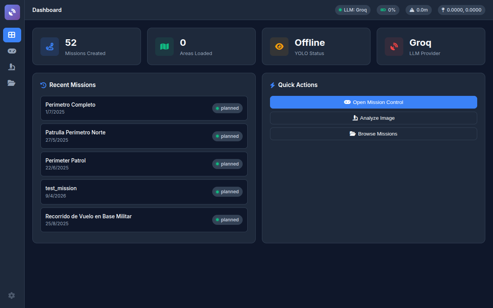
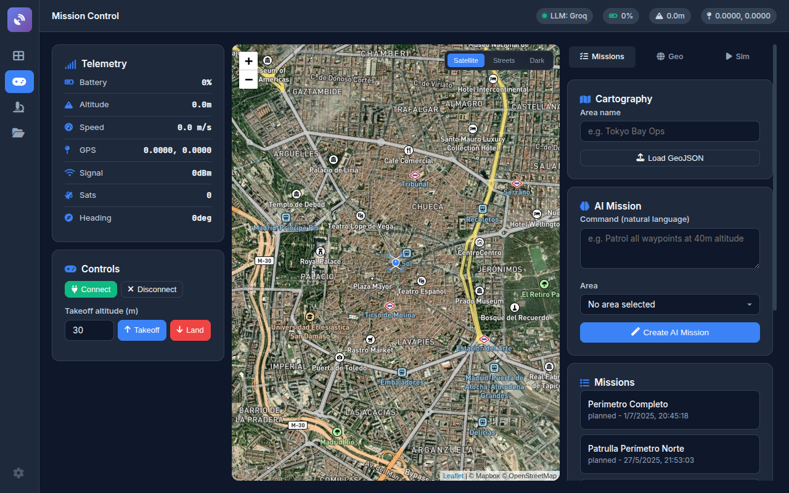
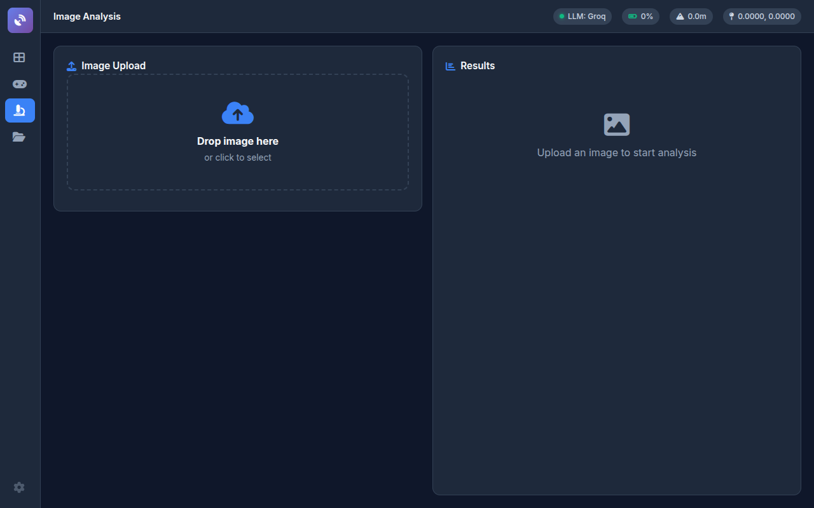
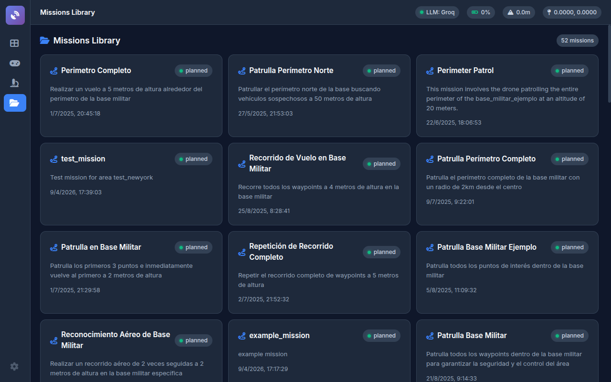

# Drone Geo Analysis

Research prototype: LLM-planned drone missions behind a deterministic safety envelope and binding human approval, plus geospatial and video analysis.

> **Status and intended use.** This is a research and security case-study prototype. It is meant to run **in simulation** (mock controllers, the bundled simulator-style executor). The Parrot ANAFI controller contains a code path for real hardware that has not been validated, and the DJI controller is a stub. Operating a real unmanned aircraft requires its own authorisation, a risk assessment and compliance with the regulations that apply where you fly (for example Implementing Regulation (EU) 2019/947 in the EU). Nothing here is a certified safety system.

## Safety model (why this repository is a security case study)

An LLM turns a natural-language order into GPS waypoints. The original validator only returned *warnings*, so a plan outside every limit was still created with `success: true` and could be executed. The fix does not try to make the model behave; it removes the model from the trust boundary:

1. **Safety envelope** (`src/safety/envelope.py`): pure, deterministic and fail-closed limits (altitude, geofence and exclusion zones, distance from home, segment length, speed, duration against battery with reserve, action allow-list). No LLM is involved.
2. **Binding approval** (`src/safety/approval.py`): the operator approves the exact canonical hash of the mission; the token is single-use, expires, and is checked again at execution time against the file actually on disk.
3. **One control point**: `MissionExecutor.start` is the only way a mission becomes executable, and controllers refuse anything that is not an `ApprovedMission`. Every controller also checks each `move_to` against the envelope.
4. **Untrusted inputs** (operator order, situation reports, text seen in video) are delimited and parsed with strict schemas. That *mitigates*; the guarantee is the envelope.

Measured in simulation, with a recording mock controller (N = 30 per vector, Wilson 95 % interval; full data in [`evaluation/metrics.json`](evaluation/metrics.json)):

| Vector (out-of-envelope input) | Reached controller before | Reached controller after |
|---|---|---|
| Compromised LLM: altitude / geofence / exclusion zone / segment / battery / action / speed | 30/30 each (0.89-1.00) | 0/30 each (0.00-0.11) |
| Compromised LLM: malformed mission | 15/30 (0.33-0.67) | 0/30 (0.00-0.11) |
| Stored mission replaced after validation | 30/30 (0.89-1.00) | 0/30 (0.00-0.11) |
| Compromised in-flight amendment | no code path existed | 0/210 (0.00-0.02) |
| Plain out-of-envelope operator orders to a real LLM (`gpt-oss:120b-cloud`, 3 x 24 orders) | 39/72 plans out of envelope, all 39 executed (0.91-1.00) | 41/72 plans out of envelope, 0 executed (0.00-0.09 of the 41) |

The in-envelope control group still runs (30/30 synthetic; 58/60 LLM orders, the other two being LLM plans that were genuinely out of envelope). The Tokyo evaluation scenario uses a 2000 m radius and 2000 m segments (`evaluation/scenario_tokyo.json`, cited in `metrics.json`) because the bundled area has points of interest up to 1.6 km apart. This differs on purpose from the library defaults (500 m radius and 1000 m segments, a conservative approximation to visual line of sight that the operator must verify): the EU open category requires VLOS, which a 2 km radius does not generally satisfy.

Indirect injection through `situation_report` or video text was **not measured** because no LLM consumes those channels in this code base. See [docs/case-study.md](docs/case-study.md), [docs/threat-model.md](docs/threat-model.md) and [docs/safety-envelope.md](docs/safety-envelope.md).



## Screenshots

### Mission Control -- Satellite Map + AI Mission Planner


### Image Analysis -- YOLO Object Detection


### Missions Library -- 52 Planned Operations


## How It Works

```
Natural Language Command -> LLM Mission Planner -> GPS Waypoints + Actions
                                                         |
Drone (Parrot ANAFI) <- Telemetry Streaming <- Mission Execution Engine
         |
    Video Feed -> YOLO Detection -> Geo Correlation -> Change Detection
```

The operator describes a mission in natural language. The LLM (Groq/Llama, OpenAI, Ollama or a local runner) proposes GPS waypoints, altitudes and actions. The deterministic envelope accepts or rejects the plan, the operator approves the exact mission hash, and only then can the (simulated) drone execute it while video is processed by YOLO for object detection and geographic change analysis.

## Features

- **Mission Control**: Satellite map (Mapbox), real-time telemetry, LLM-powered mission planning from natural language
- **YOLO Detection**: YOLOv11 object detection on drone imagery
- **Geo Analysis**: Triangulation, geographic correlation, change detection
- **52 Missions**: Library of planned ISR operations (perimeter patrols, base surveillance, reconnaissance)
- **Parrot ANAFI**: controller with a simulated mode and an unvalidated Olympe SDK path (see the status note above)
- **Multi-LLM**: Groq (Llama 4 Scout), OpenAI, Docker Model Runner (local/offline)
- **Cartography**: GeoJSON area management with POIs and security boundaries
- **Chat Interface**: LangGraph ReAct agent for querying analysis results

## Tech Stack

| Layer | Technology |
|-------|-----------|
| Backend | Flask + Waitress (production WSGI) |
| LLM | Groq API (Llama 4 Scout) / OpenAI / Docker Model Runner |
| Object Detection | YOLOv11 (Ultralytics 8.3) + PyTorch 2.5 |
| Drone SDK | Parrot Olympe 7.7.5 (ANAFI control) |
| Maps | Leaflet + Mapbox (satellite/dark tiles) |
| Geo | GeoJSON, triangulation, correlation |
| Agent | LangGraph ReAct (mission planning + Q&A) |
| Deploy | Docker Compose (4GB limit, health checks) |

## Architecture

```
src/
  controllers/          # Flask blueprints (API routes)
    analysis_controller.py    # Image upload, YOLO, chat
    drone_controller.py       # Drone connect/takeoff/land
    geo_controller.py         # Triangulation, change detection
    mission_controller.py     # Mission CRUD, LLM planning
  services/             # Business logic
    analysis_service.py       # Image processing pipeline
    drone_service.py          # Parrot ANAFI integration
    geo_service.py            # Geographic calculations
    mission_service.py        # Mission orchestration
    chat_service.py           # LangGraph ReAct agent
  models/               # Domain models
    geo_analyzer.py           # Geographic analysis engine
    mission_planner.py        # LLM mission generation
    yolo_object_detector.py   # YOLOv11 inference
  drones/               # Hardware abstraction
    base_drone.py             # Abstract drone interface
    parrot_anafi_controller.py # Parrot ANAFI implementation
  geo/                  # Geospatial primitives
  processors/           # Data processing (change detection, video)
  templates/            # Jinja2 HTML (SPA dashboard)
  static/               # CSS, JS, assets
tests/                  # 44 test files, 391 pytest tests (+ 107-test services runner, 95.3%)
cartography/            # GeoJSON area definitions
missions/               # Saved mission files
```

## Quick Start

```bash
git clone https://github.com/infantesromeroadrian/Drone-GeoAnalysis-LLMs.git
cd Drone-GeoAnalysis-LLMs
cp .env.example .env
# Edit .env with your API keys (Groq, Mapbox)

docker-compose up --build
# Open http://localhost:4001
```

### Local (without Docker)

```bash
pip install -r requirements.txt
python src/main.py
# Open http://localhost:5000
```

## Environment Variables

| Variable | Description | Required |
|----------|-------------|----------|
| `LLM_PROVIDER` | `groq`, `openai`, or `docker` | Yes |
| `GROQ_API_KEY` | Groq API key | If provider=groq |
| `OPENAI_API_KEY` | OpenAI API key | If provider=openai |
| `SECRET_KEY` | Flask session key | Yes |
| `MAPBOX_TOKEN` | Mapbox public token (satellite tiles) | Optional |
| `OPERATOR_API_KEY` | Key for `POST /api/missions/<id>/approve`; unset disables approvals (fail-closed) | Yes, to execute missions |
| `SAFETY_ENVELOPE_FILE` | JSON overriding the envelope defaults (see `config/safety_envelope.example.json`) | Optional |
| `SAFETY_AUDIT_LOG` | Append-only JSONL audit trail (never contains the key or a full token) | Optional |
| `LLM_PROVIDER=ollama` | Ollama (`OLLAMA_BASE_URL`, `OLLAMA_MODEL`, `OLLAMA_API_KEY`) | Optional |

## Testing

```bash
# Services smoke runner (107 tests). Full pytest suite = 476 tests (475 passed, 1 skipped; incl. hypothesis property tests)
python tests/services_test/run_services_tests.py

# Individual services
python tests/services_test/run_services_tests.py geo_service
python tests/services_test/run_services_tests.py drone_service
python tests/services_test/run_services_tests.py mission_service
```

| Module | Tests | Success |
|--------|-------|---------|
| GeoService | 31 | 100% |
| DroneService | 32 | 96.9% |
| MissionService | 29 | 96.6% |
| AnalysisService | 15 | 80% |
| **Total** | **107** | **95.3%** |

### Local development setup

**Python version requirement:** 3.10–3.13 (torch 2.5.1 does not support Python 3.14+).

If your system Python is outside this range, install a compatible version with `pyenv`:

```bash
# Install pyenv if not present (Linux/macOS)
curl https://pyenv.run | bash

# Install Python 3.11 (recommended, matches CI):
pyenv install 3.11
pyenv local 3.11   # writes .python-version in this directory

# Verify:
python --version   # should show 3.11.x
```

Then create the venv and install:

```bash
python -m venv .venv
source .venv/bin/activate
pip install -r requirements-dev.txt
pytest
```

**Why this matters:** `requirements.txt` pins `torch==2.5.1` which only ships wheels for Python 3.10–3.13. Newer Python versions will fail at `pip install` with "no matching distribution" errors.

The Docker container uses Python 3.11-slim, matching CI exactly. If you cannot install Python 3.11 locally, run via Docker:

```bash
docker-compose up --build
```

## License

Copyright (C) 2025-2026 Adrián Infantes Romero. Licensed under the **GNU Affero General Public License v3.0** (see [LICENSE](LICENSE), SPDX `AGPL-3.0-only`).

Earlier revisions of this repository carried a proprietary notice; from this change onwards the code is AGPL-3.0. The licence is compatible with the pinned `ultralytics==8.3.0` (AGPL-3.0) and the bundled `yolo11n.pt` weights, which remain under their own AGPL terms. If you run a modified version as a network service you must offer its source to its users.

---

Built by [Adrian Infantes](https://github.com/infantesromeroadrian)
